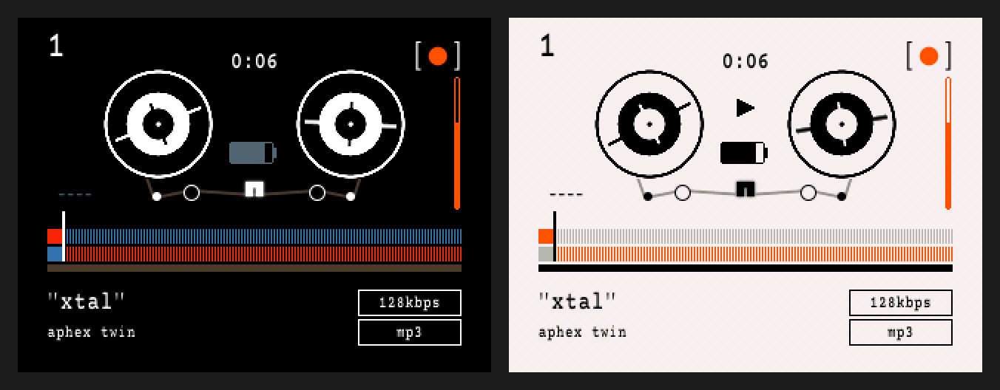
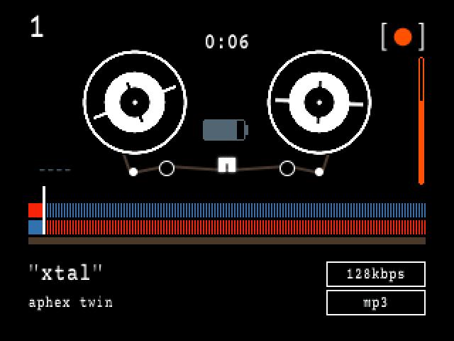
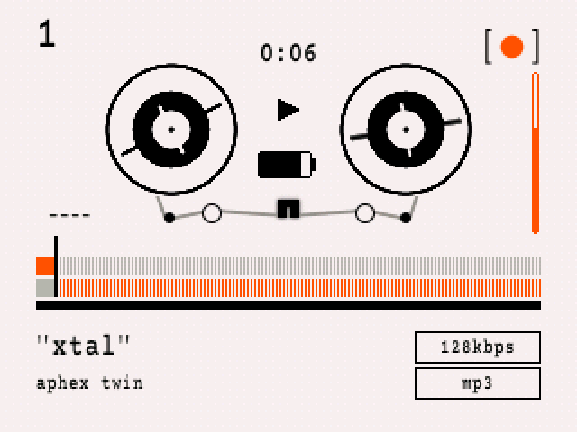

# papel-engineering

`[●]™` "papél" c/o jorge cuza: the **reel players** for the papél Rockbox theme on the iPod Video (320×240). Each is a tape deck with spinning reels:

- **papel-reel** (black): 60-frame motion-blurred reels at 25 fps, a lowercase quoted title, white outline tags, an orange volume bar, and the `[●]` mark top right.
- **papel-reel-paper** (off-white): the same deck recoloured to the papél paper palette, with black reels on paper and orange only for signal.

Both are adaptations of **OP_1 by CHUCK_LARDO** (CC-BY-SA 4.0).

## "install"

These players plug into the main papél theme. Install that first: menus, fonts, language and the **papél firmware**, which provides the 25 fps reels and lowercase text. Everything is in [**jorgecuza92/papel**](https://github.com/jorgecuza92/papel).

1. Install papél (firmware + theme) by following the steps in [papel](https://github.com/jorgecuza92/papel#install-full-edition).
2. Download this repo: green **Code** button, then **Download ZIP**. Unzip it.
3. Plug in the iPod and show hidden files: `Cmd + Shift + .` in Finder on a Mac. On Windows, View, then tick "Hidden items".
4. Copy everything inside `theme/.rockbox/` into the iPod's `.rockbox/` folder, merging folders.
5. Eject, unplug, and restart: hold **Menu + Select**.
6. On the iPod go to **Settings, then Theme Settings, then Browse Theme Files** (`set`, then `theme_set`, then `brws_theme_files`). Pick **papel-reel** or **papel-reel-paper**.

To go back to the big-type player, pick **papel** in the same list.

## "inside"

| path | what |
|---|---|
| `theme/.rockbox/wps/papel-reel.wps` + `papel-reel/` | black reel player and its images (reels, backdrop, icons, bar, mark) |
| `theme/.rockbox/wps/papel-reel-paper.wps` + `papel-reel-paper/` | off-white reel player, recoloured images |
| `theme/.rockbox/fonts/` | Courier Prime Papel at 20, 20 bold, 22 bold and 32 px |
| `theme/.rockbox/themes/papel-reel*.cfg` | one-pick theme files (reel player + papél menus) |

## "credit"

- **Reel players:** adapted from **OP_1 by CHUCK_LARDO**, licensed [CC-BY-SA 4.0](https://creativecommons.org/licenses/by-sa/4.0/). These adaptations are CC-BY-SA 4.0 too ([LICENSE.md](LICENSE.md)). The changes are listed there.
- **Adaptation:** design "papél" c/o Jorge Cuza: github.com/jorgecuza92/papel-engineering.
- **Fonts:** Courier Prime Papel (bitmap), from Courier Prime: SIL OFL 1.1, © 2015 The Courier Prime Project Authors.
- **Related:** the papél theme and firmware are at [papel](https://github.com/jorgecuza92/papel), and the brand library is at [papel-ui-library](https://github.com/jorgecuza92/papel-ui-library).

Inspired by the catalogue and wall-text language of Virgil Abloh. papél is an independent personal project, not affiliated with him, his estate, Rockbox, Teenage Engineering or Apple.
